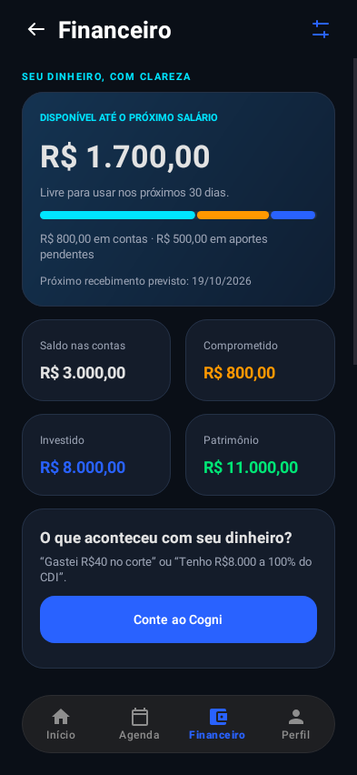
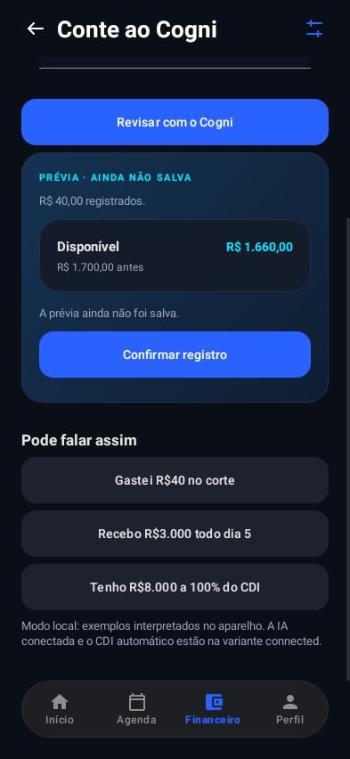
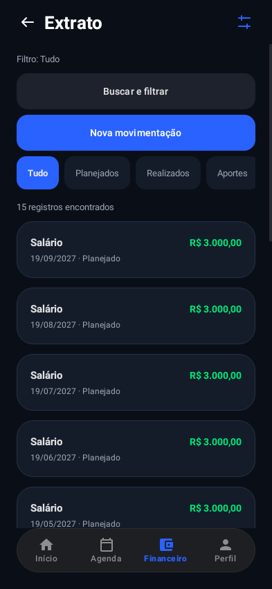
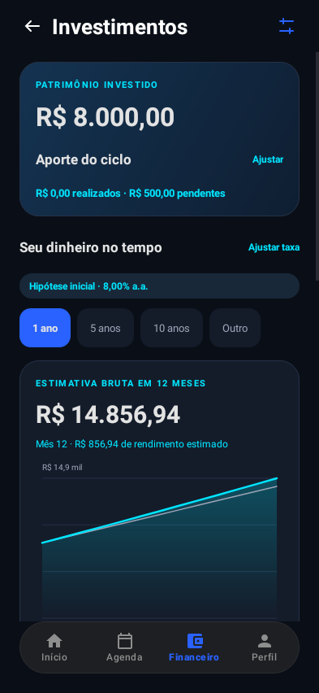
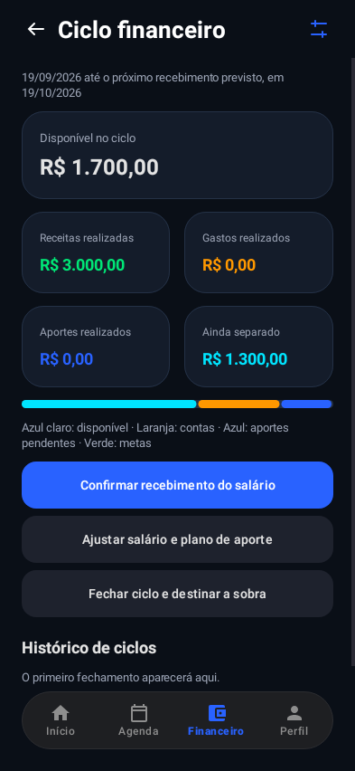
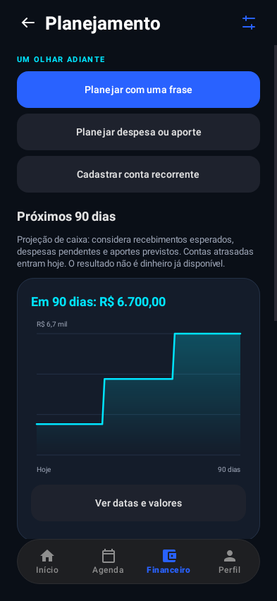
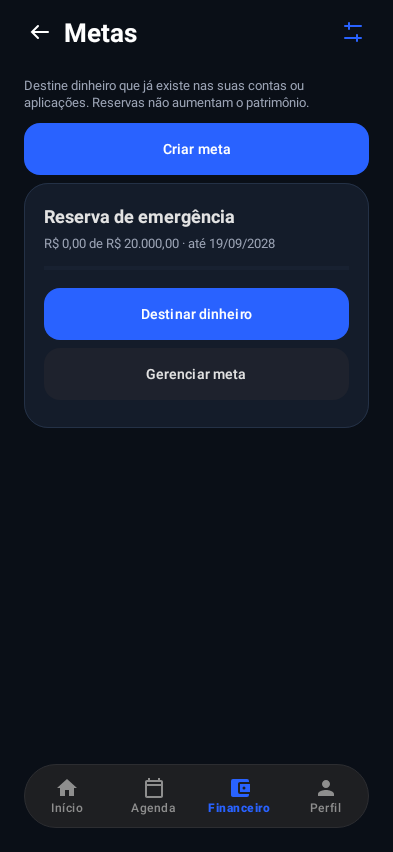
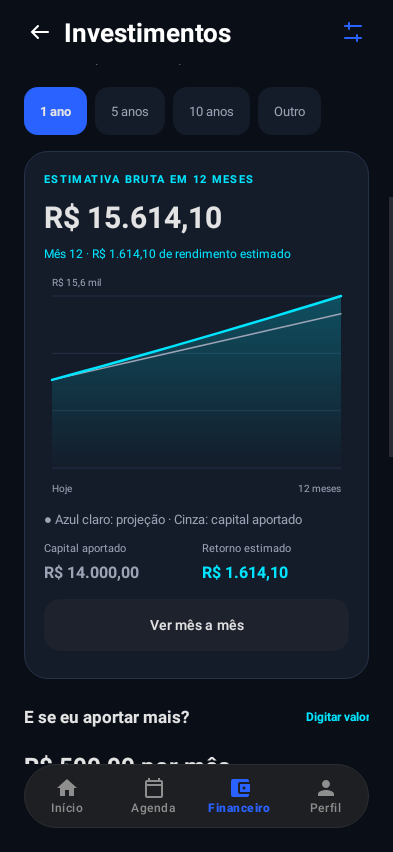
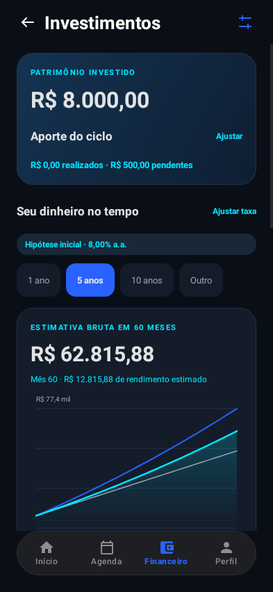

# Cogni

**Organizador pessoal com agenda, finanças e um assistente de IA que entende frases do dia a dia.**

Você escreve do jeito que fala, por exemplo *"dia 18 vou ao cinema às 21h30 e gastar R$ 60"* ou *"gastei R$ 40 no corte"*, e o Cogni transforma isso em compromissos, previsões de gasto, lançamentos e metas. Tudo aparece junto, na agenda e no financeiro.

App Android nativo, em Java, com Firebase e IA via Groq.

<p align="center">
  
  
  
  
</p>

---

## Funcionalidades

### Início e assistente
- Campo **"Peça ao Organizador"**: uma frase pode gerar vários itens de uma vez, por exemplo um jantar às 19h e um cinema às 21h30, cada um com seu valor.
- Indicador **"Organizador está agendando..."** enquanto a IA processa.
- Lista das **próximas tarefas**. Compromissos com custo mostram o valor colorido: **previsto** em amarelo, **pago** em vermelho.
- A IA nunca registra como pago algo com data futura: isso vira compromisso ou gasto previsto.

### Agenda
Calendário mensal com **uma bolinha por categoria em cada dia**:

| Cor | Significado |
|---|---|
| 🔵 Azul | Compromisso |
| 🟡 Amarelo | Gasto previsto (ainda não pago) |
| 🟢 Verde | Recebimento (previsto ou recebido) |
| 🔴 Vermelho | Gasto realizado |

Ao tocar num dia, a lista mostra os compromissos e também as receitas e os gastos daquele dia, nas mesmas cores. Para trocar de mês, use as setas ou deslize para o lado.

### Financeiro

| Área | O que faz |
|---|---|
| **Visão geral** | Quanto está disponível até o próximo salário, além de saldo, comprometido, investido e patrimônio. |
| **Conte ao Cogni** | Frases com prévia e confirmação antes de salvar. Nada é gravado sem você conferir. |
| **Ciclo** | Salário e dia de recebimento, recebimentos parciais, receitas e despesas do ciclo, fechamento e destino da sobra. |
| **Investimentos** | Posição por aplicação, aporte fixo ou % do salário, resgates, projeções para 1, 5 e 10 anos ou prazo personalizado, comparação de cenários e cálculo do aporte necessário para uma meta. |
| **Metas** | Objetivo, prazo, progresso, reservas e simulação do aporte necessário. |
| **Extrato** | Realizados (mais recente em cima) e planejados (mais próximo em cima), com busca, filtro por período e tipo, estorno e correção com histórico. |
| **Planejamento** | Gastos futuros, **gastos fixos/assinaturas com data final opcional** e projeção de caixa para 90 dias. |
| **Contas** | Contas de movimentação e aplicações, transferências internas e reconciliação de saldos. |

O **CDI** vem da API pública do Banco Central ([série SGS 12](https://api.bcb.gov.br/dados/serie/bcdata.sgs.12/dados/ultimos/10?formato=json)), com a data da observação, cache e aviso quando o valor está desatualizado. Se a consulta falhar, o app não inventa uma taxa.

<p align="center">
  
  
  
  
  
</p>

---

## Exemplos de frases

```text
Dia 18 vou ao cinema às 21h30 gastar R$60 e antes, às 19h, R$450 no japonês
Amanhã vou cortar o cabelo às 9h por R$45
Gastei R$40 no corte
Ganhei R$1.000 de um freelance hoje
Assinatura do Claude de R$110 todo dia 21 até fevereiro de 2027
Todo dia 5 recebo R$3.000 e quero investir R$500
Tenho R$8.000 a 110% do CDI e aporto R$500 por mês por 5 anos
Quanto preciso investir para chegar a R$100 mil em 5 anos?
```

Um compromisso com custo cria, de uma só vez, o item na agenda e a previsão no financeiro: ou os dois são salvos, ou nenhum é. Quando você registra o gasto depois (*"gastei R$40 no corte"*), o Cogni encontra a previsão correspondente e a marca como paga. Se houver mais de uma candidata, ele pergunta qual é.

---

## Tecnologias

- **Java 11** · Android SDK 37 (mínimo 24) · AGP 9.3 · Material Components
- **Firebase Authentication** (e-mail/senha) e **Cloud Firestore**
- **Groq** (`openai/gpt-oss-120b`) via Retrofit para interpretar as frases
- API pública do **Banco Central** para o CDI
- Room (registros locais legados)

---

## Como rodar

### 1. Abrir o projeto
1. No Android Studio, abra **File → New → Project from Version Control** e cole a URL deste repositório.
2. Aguarde o **Gradle Sync**.
3. Em **View → Tool Windows → Build Variants**, escolha a variante:
    - **`connectedDebug`**: usa Firebase, IA e CDI reais.
    - **`localDebug`**: roda offline, com dados só no aparelho e sem login (app **Cogni Local**).
4. Selecione o emulador ou o celular e clique em ▶.

### 2. Chave da IA (opcional)
No arquivo **`local.properties`**, na raiz do projeto (ao lado da linha `sdk.dir`), coloque:

```properties
GROQ_API_KEY=SUA_CHAVE
```

Escreva sem aspas. **Nunca envie esse arquivo ao GitHub**: ele já está no `.gitignore`. Sem a chave, o app usa um interpretador local que reconhece os exemplos principais.

### 3. Firebase
A variante `connectedDebug` usa o `app/google-services.json` do projeto. Para usar outro projeto Firebase:

1. Crie o projeto no [console do Firebase](https://console.firebase.google.com) e adicione um app Android com o pacote `com.example.organizadoria`.
2. Substitua o `app/google-services.json` pelo arquivo do seu projeto.
3. Ative **Authentication → E-mail/senha**.
4. Crie o **Firestore** em modo de produção e publique estas regras:

```
rules_version = '2';
service cloud.firestore {
  match /databases/{database}/documents {
    match /users/{uid}/{document=**} {
      allow read, write: if request.auth != null && request.auth.uid == uid;
    }
  }
}
```

> ⚠️ Não use as regras do **modo de teste** em uso contínuo: elas expiram em 30 dias e, a partir daí, o app para de ler e gravar.

---

## Regras de cálculo

Valores em dinheiro são armazenados em **centavos** (`long`). Movimentações nunca usam `double`.

```text
Saldo        = dinheiro nas contas de movimentação
Comprometido = despesas pendentes antes do próximo salário, incluindo atrasadas
Disponível   = saldo − comprometido − aportes pendentes − reservas
Investido    = posições nas contas de investimento
Patrimônio   = saldo + investido
```

- **Salário cadastrado é previsão.** Só a confirmação do recebimento cria receita e reserva o aporte do ciclo. O percentual de aporte é calculado sobre o valor confirmado.
- **Aporte** transfere de uma conta para um investimento: o saldo diminui, o investido aumenta e o patrimônio continua igual. Resgate faz o movimento inverso.
- **Reserva para meta** aponta para dinheiro que já existe, sem criar outro ativo.
- **Pagamento menor que o previsto** encerra a previsão e libera a diferença. Exemplo: R$ 45 previstos e R$ 40 pagos liberam R$ 5. Pagamento parcial mantém o restante pendente.
- **Aportes são parciais por padrão**: R$ 350 realizados sobre R$ 500 planejados deixam R$ 150 pendentes.
- **Gastos fixos** geram previsões por até 12 meses à frente, ou até a data final informada. Dias 29 a 31 inexistentes caem no último dia do mês.
- **Projeções** usam taxa anual efetiva convertida para mensal, com aportes ao fim do mês. São estimativas brutas, sem impostos, taxas ou inflação, e não são retorno garantido. A projeção do CDI usa 252 dias úteis por ano e 21 por mês.

---

## Organização do código

```
app/src/main/java/com/example/organizadoria/
├── MainActivity.java            Início + campo de comandos
├── AgendaActivity.java          Agenda com calendário e lista do dia
├── MonthCalendarView.java       Calendário com bolinhas por categoria
├── AgendaFeed.java              Compromissos novos e legados
├── TarefaAdapter.java           Cards de compromissos, receitas e gastos
├── RemoteCommandCodec.java      Prompt e validação do JSON da IA
├── AppSession / AppServices     Sessão, armazenamento e execução em segundo plano
└── financeiro/
    ├── domain/                  Regras: FinanceState, FinanceEngine, CommandRouter,
    │                            Projection, InvestmentProjection, LocalCommandParser
    ├── data/                    FirestoreFinanceRepository (conectado)
    │                            FileFinanceRepository (local, gravação atômica)
    ├── network/                 CDI do Banco Central
    └── ui/                      Telas, formulários e gráficos do Financeiro
```

No Firestore, os dados ficam em `users/{uid}/financeiro_v1`, um documento por entidade, com controle de revisão e detecção de conflito entre aparelhos. A coleção antiga `users/{uid}/tarefas` continua sendo lida para mostrar os compromissos anteriores.

---

## Testes

Sem precisar do Android SDK (JDK 17+ e Python 3):

```bash
bash tools/run_finance_tests.sh
java tools/CheckJavaSyntax.java
python3 tools/check_android_resources.py
```

Com o SDK instalado:

```bash
./gradlew :app:assembleLocalDebug :app:assembleConnectedDebug :app:testLocalDebugUnitTest
./gradlew :app:connectedLocalDebugAndroidTest   # precisa de emulador ou aparelho
```

Os testes de instrumentação usam a variante `local`, com dados sintéticos. Não rode testes na variante `connected` contra os serviços reais.

Mais detalhes da validação do financeiro estão em [docs/FINANCEIRO_VALIDACAO.md](docs/FINANCEIRO_VALIDACAO.md).

---

Feito por [Amanda Mayumi](https://github.com/Amand4May).